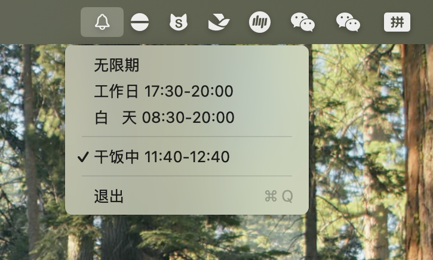
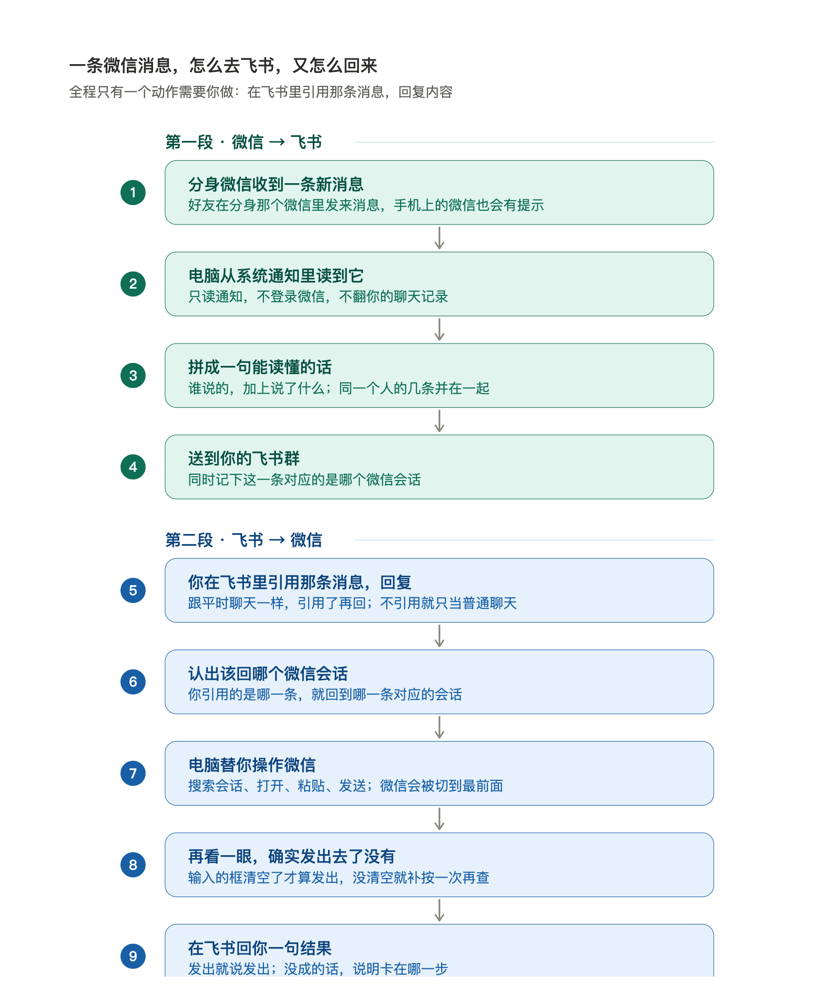

# WeChat-Push

把微信（分身）的新消息推到飞书，在飞书里引用那条消息回复，内容会发回对应的微信会话。



## 它解决什么

电脑上登着微信分身，人不在电脑前，消息看不到也回不了。
手机上装的是飞书，微信不在手边。

这个程序把两头接起来：微信来了消息推到飞书群，你在飞书里引用它回一句，程序自动去微信里把这句话发出去。

## 怎么跑的



**消息进来**：程序轮询 macOS 的通知数据库，读到微信分身的通知，按会话整理成「谁：说了什么」，发到指定的飞书群，同时记下这条飞书消息对应哪个微信会话。

**回复回去**：程序轮询同一个飞书群，发现有消息引用了之前推送的那条，就取出它对应的微信会话名，用键盘快捷键在微信里搜索会话、打开、粘贴、回车。发完截图核对输入框是否清空，结果回到群里。

全程不需要登录微信协议，也不读聊天记录，只读系统通知。

## 环境要求

- macOS 13 及以上
- Xcode 命令行工具（`xcode-select --install`）
- 微信 4.x 已登录（在 `/Applications/WeChat2.app`）
- 一个飞书自建应用，和一个接收推送的群

## 安装

### 1. 编译

```bash
git clone https://github.com/wwJay1024/WeChat-Push.git
cd WeChat-Push
./build.sh
```

编译产物在 `~/Applications/WeChat2Push.app`。`build.sh` 会自动取本机第一个 Apple Development 证书签名，没有证书时用临时签名。

### 2. 建飞书应用

到[飞书开放平台](https://open.feishu.cn/app)建一个企业自建应用，然后：

1. 开通权限：发送消息、读取群消息（`im:message:send_as_bot`、读取群历史消息）
2. 发布版本并等待审核通过（自建应用一般即时生效）
3. 把机器人拉进你要接收推送的群
4. 记下三项：`App ID`、`App Secret`、群的 `chat_id`
5. 记下你自己的 `open_id`

`chat_id` 和 `open_id` 可以用接口查，也在群设置和成员信息里能看到。

### 3. 写配置

```bash
mkdir -p ~/Library/Application\ Support/WeChat2Push
cp config.example.json ~/Library/Application\ Support/WeChat2Push/config.json
```

把四个字段换成自己的：

| 字段 | 说明 |
|---|---|
| `app_id` | 飞书应用的 App ID |
| `app_secret` | 飞书应用的 App Secret |
| `chat_id` | 接收推送的群 |
| `owner_open_id` | 你自己的 open_id，只有这个人的消息会被执行 |

`owner_open_id` 留空等于放开给群里所有人，别留空。

### 4. 授权

```bash
open ~/Applications/WeChat2Push.app
```

第一次运行会被系统拦下，到「系统设置 → 隐私与安全性」里给 `WeChat2Push.app` 两项权限：

- **完全磁盘访问**：用来读通知数据库
- **辅助功能**：用来发键盘事件操作微信

两项都加完，退出程序再打开一次。菜单栏出现铃铛图标就正常了。

### 5. 开机自启（可选）

在 `~/Library/LaunchAgents/` 放一个 launchd 配置，指向 `~/Applications/WeChat2Push.app/Contents/MacOS/WeChat2Push`，`RunAtLoad` 设为 true。

## 使用

### 菜单栏

点铃铛选会话模式，选中的模式在那个时间段内转发：

| 选项 | 说明 |
|---|---|
| 无限期 | 全天转发 |
| 工作日 17:30-20:00 | 只在工作日的这个时间段 |
| 白天 08:30-20:00 | 每天的这个时间段 |
| 干饭中 11:40-12:40 | 独立开关，工作日中午额外转发，关掉只影响当天 |
| 结束会话 | 停止转发 |

铃铛实心表示当前正在转发，空心表示不在时段内。

### 回复

在飞书群里**引用**推送的那条消息，回复内容。必须引用，直接发一条普通消息不会转发。

### 群里发指令

在群里单独发下面某个词（整条消息完全等于它，不要夹带别的字，不要引用任何消息）：

| 指令 | 效果 |
|---|---|
| `状态` | 回当前会话模式，没开会话则回「无进行中会话」 |
| `开启会话` / `无限期` | 切到无限期 |
| `工作日` | 切到工作日 17:30-20:00 |
| `每天` | 切到白天 08:30-20:00 |
| `结束会话` | 停止转发 |

只有 `owner_open_id` 对应的人发的指令才生效。

## 限制

- **会抢前台**：发送消息时会把微信切到最前面并模拟键盘，你正在做别的事会被打断。
- **依赖浅色主题**：判断「输入框有没有文字」靠像素亮度，微信切到深色主题后会一直判成失败，一条都发不出去。
- **只读通知**：通知里带的内容有长度上限，长消息会被截断；撤回、图片、语音只呈现为提示文字。
- **微信升级可能失效**：整套方法依赖微信窗口的布局和快捷键。微信 4.1.15 实测可用，换版本可能要重测。
- **窗口必须存在**：微信窗口被关掉时程序会用 `open` 唤起，唤起失败就报「微信分身没有窗口」。
- **单机单实例**：同一时间只应有一个实例在跑。

## 目录

```
main.swift          通知轮询、菜单、推送与配置
FeishuBot.swift     飞书接口：取令牌、发消息、拉消息
ReplyRouter.swift   引用回复的对应关系、群指令
WeChatSender.swift  用快捷键在微信里发送并核对结果
build.sh            编译、打包、签名
Info.plist          应用配置
AppIcon.icns        图标
```

## 说明

仅供个人在已登录的微信上做消息中转。请自行确认使用方式符合微信与飞书的服务条款。程序不上传任何数据到第三方，消息只经过你自己的飞书应用。

## 许可证

MIT
